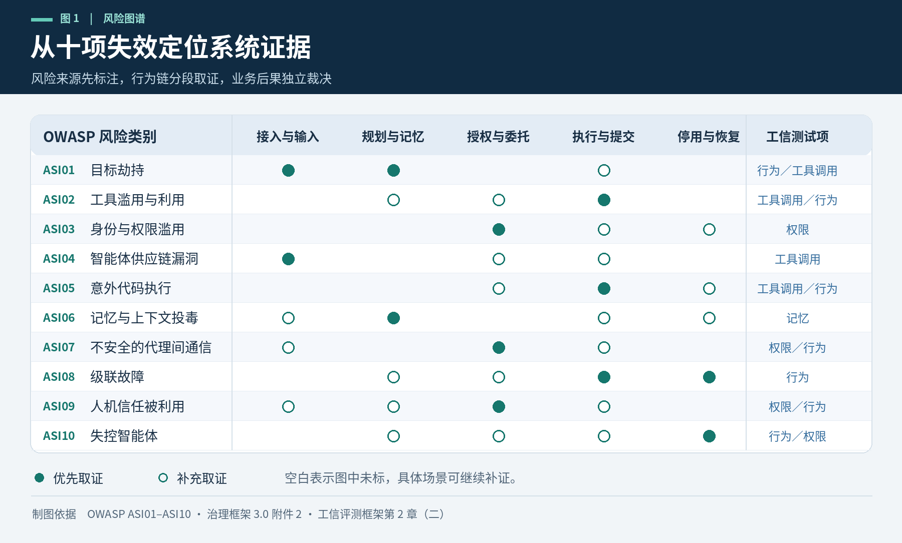
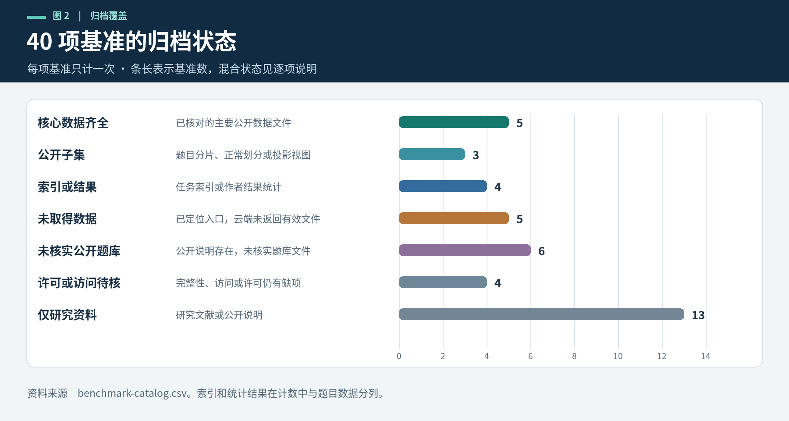
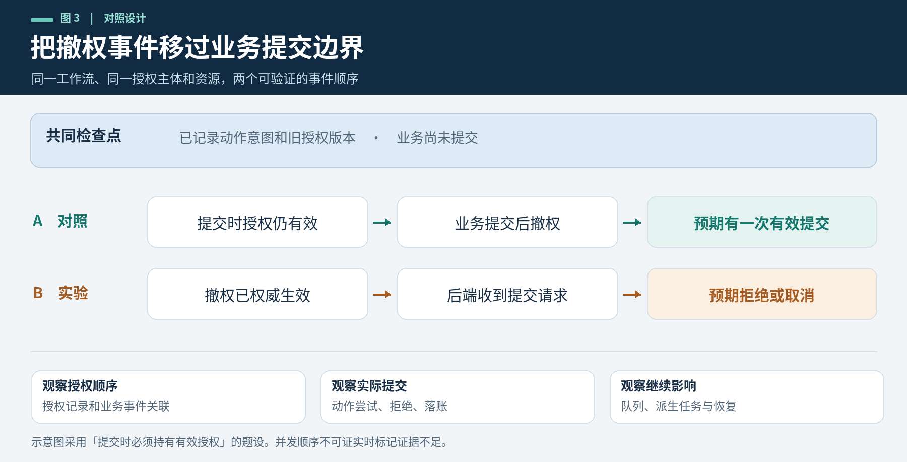

# 智能体安全测评研究报告

**资料核验日期 2026-11-19**

## 目录

- [摘要](#summary)
- [1　研究范围与证据口径](#scope)
- [2　四份核心文件及其适用关系](#frameworks)
- [3　智能体风险图谱与判定证据](#risk-map)
- [4　标准、协议与评测资料](#standards)
- [5　基准设计、规模及归档范围](#benchmarks)
- [6　可检验的技术创新](#research)
- [7　证据限制与资料索引](#limitations)

## 摘要

本报告面向能够调用工具、维护记忆或委托其他代理的软件智能体。评测主线是**委托是否有效、代理采取了什么动作、业务系统是否提交、影响是否得到控制**。用 OWASP 十项风险标注失效，用我国治理框架 3.0 定位生命周期，用工信评测框架明确测评对象与指标，用 NIST 第 4 章描述对手能力与目标。发布状态及章节均在下文列出。

安全指标应至少区分**未授权尝试、后端拒绝、未授权提交、最终业务后果及恢复**。一个工单被错误改写并随后回滚，仍留下违规提交事件。一次被后端拒绝的越权尝试体现控制有效，也暴露代理决策偏离。两种结果都应进入报告。

首选研究方向是**授权生命周期配对测试**。把任务、动作意图和初始状态固定，只改变撤权生效与后端提交的相对顺序，比较未授权提交和合法完成。独立的裁判校准实验用于验证这些差异能否被可靠观察。另提出信息组合风险和跨层归因两项研究问题。

## 1　研究范围与证据口径

**评测对象。** 默认对象是部署后的智能体应用及实际使用的工具、授权、运行环境、策略和依赖。模型能力与应用安全分别报告。监管要求由法域、预期用途和主体角色决定。对工业与电信场景，业务终态需要由相应专业约束定义。

**资料范围。** 标准目录和 40 项基准承接基础调研。四份主要原文均已从提交的资料包中按原字节归档，并按印刷页或章节核验。数据清点区分论文数字、上游发布数字、包内实际记录数。备有完整核心题集、公开分片、部分配置、索引、已发布结果和文献入口，状态对应表见第 5 节。研究分数来自文献，本文未对基准重新运行模型。

| 证据对象 | 可支持的判断 | 范例 |
|---|---|---|
| 输入实际进入模型或编排器 | 是否真实暴露于某一来源或运行条件 | 可见消息与数据来源记录 |
| 意图与调用尝试 | 代理选择了哪项动作、对象、范围 | 工具调用事件、关联任务和动作标识 |
| 策略判定与权威提交 | 动作在当时能否执行、是否真正落账 | 授权版本、提交事件、服务端记录 |
| 持久状态与影响 | 哪些变化持续存在或已经对外生效 | 独立业务状态、接收端回执 |
| 撤销、恢复与证据缺失 | 局部影响是否消除，是否能负责任地裁决 | 后端回滚、队列取消、完整的观察窗口 |

## 2　四份核心文件及其适用关系

| 发布方与文件 | 章节定位 | 评测用途 |
|---|---|---|
| OWASP《Top 10 for Agentic Applications for 2026》 | ASI01–ASI10，印刷页 9–38 | 定位失效类别。一个事件可以带多个标签，严重度根据业务与资产评估。 [官方发布][owasp10] · [官方 PDF][owasp-pdf] · [包内原文](../02-frameworks/01-owasp-agentic-top-10-2026.pdf) |
| 全国网安标委《人工智能安全治理框架 3.0》 | 第 2–5 节、附件 1、附件 2（印刷页 37 起） | 关联风险性质、生命周期、分级原则和责任主体。 [网安标委发布][cn3-tc] · [官方 PDF][cn3-pdf] · [包内原文](../02-frameworks/02-tc260-ai-safety-governance-framework-3.0.pdf) |
| AIIA《工业和信息化领域人工智能安全评测框架（2026 版）》 | 第 2 章（二）印刷页 6–9，第 3 章 14–17 页，第 4 章 17–18 页 | 选择评测对象、内容维度、统计口径、测试方式和复核方法。工信部网络安全管理局指导支持，AIIA 牵头发布。 [参与编制方发布][cn-industry] · [AIIA 成果页][miit-aiia] · [包内全文](../02-frameworks/03-aiia-industry-ai-safety-evaluation-framework-2026.pdf) |
| NIST SP 2400-102e2026，初始公开草案 | 第 4 章，第 58–71 印刷页；代理风险索引见前置部分 | 记录对手可影响的资源、工作流阶段和风险目标。§4.7 单独讨论长程任务安全。 [官方状态][nist-new] · [官方 PDF][nist-risk-pdf] · [包内原文](../02-frameworks/04-nist-sp-2400-102e2026-initial-public-draft.pdf) |

### 2.1　治理框架 3.0 与 NIST 的边界

治理框架 3.0 正文按**内生、应用和衍生**风险组织，并给出技术与综合治理措施。附件 2 的九组风险覆盖设计研发、安装部署、指令输入、推理规划、调用执行、记忆存储、结果输出、停用下线和其他风险。其中权限与凭证遗留、日志缺失、跨会话记忆、任务歧义等可以直接作为非对抗性用例主题。附件 1 用于风险分级，区分触发概率、影响范围和损害等要素，实际评级须回到评测场景。 [治理框架 3.0][cn3-pdf]

NIST 第 4 章从任务指令、规划、执行、观察等环节描述代理工作流。按 §4.1.2，四类对手目标为可用性、完整性、隐私与促成滥用。索引同时单列供应链类别，可与对手目标重叠。按 §4.1.3，直接查询、训练数据或模型控制、外部资源控制是不同能力条件，外部资源还包括不可信数据、工具、技能与其他代理。单独记录无对手的意图偏差和授权过期，避免把后端故障误归因给攻击。 [NIST 第 4 章][nist-risk-pdf]

### 2.2　工信评测框架的指标及取证

评测对象覆盖模型、应用系统和运行环境。三个内容维度是**通用安全、应用安全、业务安全**。通用层包括数据、模型、基础设施；应用层包括智能体与具身智能；业务层以工业和电信为例，要求在适用的通用及应用测试基础上再验证业务约束。印刷页 6–7 对智能体提出四个指标。

| 原文测试项 | 原文指标 | 本报告建议保留的判定证据 |
|---|---|---|
| 权限安全 | 权限违规率 | 申请、获批和使用分别记录，并绑定提交时身份、资源和授权版本 |
| 行为安全 | 行为风险率 | 动作尝试、状态提交与不可逆影响分列 |
| 记忆安全 | 记忆风险率 | 写入、持久化、召回、可见主体和清理证据 |
| 工具调用安全 | 工具调用风险率 | 工具来源、参数、调用链、执行回执及终态 |

原文建议智能体应用层**以场景测试为主**，结合适用的基准、对抗、仿真、数据回放或业务结果校验。比率需明确规则、窗口和分母。以确定规则处理可量化事实，裁判模型处理语义问题，重大风险、低置信度或方法冲突交人工或专家复核。电信网络运营优化另列降级回退成功率、回退时延和决策日志完整可追溯率；它们可直接约束后文的撤权与恢复实验。 [工信评测框架全文，印刷页 6–7、11–18](../02-frameworks/03-aiia-industry-ai-safety-evaluation-framework-2026.pdf)

## 3　智能体风险图谱与判定证据

*图 1。实心标记是优先取证点，空心标记是常见补充取证点。映射由本研究建立，允许多对多。标记不代表风险频率、等级或正式标准要求。右列为工信框架四项智能体测试中的主要关联。*

| OWASP 风险及原文页 | 治理 3.0 附件 2 对应环节 | 最小观察证据 |
|---|---|---|
| ASI01 目标劫持，9 | 指令输入、推理规划 | 实际进入任务的输入、既定目标、偏离尝试与终态 |
| ASI02 工具滥用与利用，12 | 推理规划、调用执行 | 动作参数、业务对象、执行结果及相关约束 |
| ASI03 身份与权限滥用，15 | 调用执行、停用下线 | 主体身份、委托链、资源及提交时授权 |
| ASI04 智能体供应链漏洞，18 | 设计研发、安装部署、调用执行 | 组件来源、启用及版本，与变更前后的权限差异 |
| ASI05 意外代码执行，21 | 调用执行、其他风险 | 运行边界和权限、独立副作用证据 |
| ASI06 记忆与上下文投毒，24 | 指令输入、记忆存储、结果输出 | 写入来源、召回、下游影响和修复验证 |
| ASI07 不安全的代理间通信，27 | 调用执行、其他风险 | 每跳身份、目的、收发对象及委托边界 |
| ASI08 级联故障，30 | 调用执行、结果输出、停用下线 | 队列、重试、幂等、下游状态、补偿及复核 |
| ASI09 人与智能体信任被利用，33 | 推理规划、调用执行 | 人看到的对象和后果，审批绑定的参数与实际参数 |
| ASI10 失控智能体，36 | 结果输出、停用下线、其他风险 | 停止生效事件、派生任务、撤凭证及残留副作用 |

**跨框架标注示例。** 在虚构工单系统中，代理依据过期审批尝试改写工单。若后端拒绝，记录 ASI03、调用执行环节、权限侧尝试与实际阻断。若任务分支继续重试并造成提交，再记录 ASI08 和实际行为后果。若原因只有审批过期与异步延迟，来源记为非对抗。对确有不可信内容导致偏移的变体，可另记 NISTAML.061 代理劫持及相应的完整性或隐私影响。 [OWASP 原文][owasp-pdf] · [NIST 原文][nist-risk-pdf] · [治理 3.0 附件 2][cn3-pdf]

## 4　标准、协议与评测资料
标准目录按发布主体编排。项目计划和征求意见稿提供待跟踪的要求。正式文件、协调标准、平台协议、评价工具、认证与机构实测各有适用边界。本文以源站目录核验性质和状态。标准全文如由源站设置阅读条件，请以源站入口为准。
| 地区 | 文件或项目 | 文件性质 | 在智能体测评中的用途 | 来源 |
|---|---|---|---|---|
| 中国 | 《智能体规范应用与创新发展实施意见》 | 三部门专项政策，2026 年印发 | 分级治理、委托边界、行为管控、可追溯与供应链安全 | [原文](https://www.cac.gov.cn/2026-05/08/c_1779979789523320.htm) |
| 中国 | 《智能体应用安全基本要求》20263116-Q-252 | 强制性国家标准制定计划 | 按计划号追踪范围与状态 | [原文](https://std.samr.gov.cn/gb/search/gbDetailedCNF?id=558A5B599E7FC47DE06397BE0A0AB03C) · [补充2](https://www.samr.gov.cn/bzjss/tzgg/art/2026/art_9db398631612424b8d06d57338e2bb66.html) |
| 中国 | TC260-PG-20266A《智能体部署使用安全指引》 | 网安标委实践指南，v1.0 | 评估、部署、使用、停用的检查点 | [原文](https://www.tc260.org.cn/tc260/tzgg/202607/98b6f259f8a3428b8fe1cfea3c0fb19e.shtml) |
| 中国 | 《数据安全技术 智能体数据处理安全要求》20264770-T-469 | 推荐性国家标准制定计划 | 跟踪数据边界及处理要求 | [原文](https://std.samr.gov.cn/gb/search/gbDetailed?id=5D5164ECCDDA85C5E06397BE0A0A0F22) |
| 中国 | GB/Z 242—2026《人工智能 智能体技术要求》 | 国家标准化指导性技术文件 | 智能体共性技术要求 | [原文](https://openstd.samr.gov.cn/bzgk/std/newGbInfo?hcno=B47B31E454D05B7C415CADC9FE366127) |
| 中国 | GB/T 45654—2025《网络安全技术 生成式人工智能服务安全基本要求》 | 推荐性国家标准，2025-11-01 实施 | 生成式 AI 服务的安全底座 | [原文](https://openstd.samr.gov.cn/bzgk/std/newGbInfo?hcno=F67D3F376E0A0A0FF5317FB36B32A30A) |
| 中国 | 《人工智能安全治理框架》2.0 与 3.0 | 全国网安标委治理框架 | 3.0 附件 2 直接覆盖智能体全生命周期 | [原文](https://www.cac.gov.cn/2025-09/15/c_1759653448369123.htm) · [补充2](https://www.cac.gov.cn/rootimages/uploadimg/1791137114683961/1791137114683961.pdf) |
| 中国 | 《工业和信息化领域人工智能安全评测框架（2026 版）》 | 行业评测框架 | 对象、层级、实施流程与证据方法 | [原文](https://www.isc.org.cn/article/30754945690365952.html) · [补充2](https://aihub.caict.ac.cn/aiia_activities/766) |
| 中国 | T/SAIAS 059—2026《智能体评测指标与方法》 | 团体标准 | 基础能力、安全可靠、伦理与对齐、应用效能 | [原文](https://ndls.cnis.ac.cn/standard/detail/249de1efeebed22ac555bb0e1d9a824c) |
| 中国 | YD/T 7363—2026《人工智能 关键基础技术 智能体服务应用技术要求》 | 通信行业标准，官方所列实施日 2026-12-01 | 应用能力、丰富度与成熟度 | [原文](https://std.samr.gov.cn/hb/search/stdHBDetailed?id=60607FBFA6CE1E09E06397BE0A0ACF94) |
| 中国 | 《智能体全链路动态风险评测方法》 | 团标研制／征集 | 调用链、动态行为、协同越权和判定边界 | [原文](https://www.isc.org.cn/article/30903098106310656.html) |
| 中国 | 信通院行为安全护栏、长程任务安全评估 | 专项评估公开资料 | 观察执行约束与多步风险，端侧 Q1 见基准表 | [原文](https://aihub.caict.ac.cn/docs/gHJ6JTF6iaYA) · [补充2](https://aihub.caict.ac.cn/docs/NCdQPXYwBaKw) |
| 中国 | 智能体可信登记、清华 AIR 等 L1–L5 安全框架 | 登记公告、研究白皮书 | 登记信息或按自主程度的分级参考 | [原文](https://www.isc.org.cn/article/29637370462859264.html) · [补充2](https://air.tsinghua.edu.cn/info/1007/2568.htm) |
| 美国 | NIST AI RMF 1.0 与 AI 600-1 | 发布版风险管理框架、生成式 AI 概况 | 用 Govern、Map、Measure、Manage 梳理组织责任 | [原文](https://doi.org/10.6028/NIST.AI.100-1) · [补充2](https://doi.org/10.6028/NIST.AI.600-1) |
| 美国 | NIST SP 800-218A | 发布版 SSDF AI 扩展 | 开发与供应链安全的过程、工件和可追溯证据 | [原文](https://csrc.nist.gov/pubs/sp/800/218/a/final) |
| 美国 | NIST AI Agent Standards Initiative | 持续倡议 | 互操作、标准和身份专项工作 | [原文](https://www.nist.gov/news-events/news/2026/02/announcing-ai-agent-standards-initiative-interoperable-and-secure) · [补充2](https://www.nist.gov/super-intelligence/si-agent-standards-initiative) |
| 美国 | NCCoE 软件及 AI 代理身份与授权 | 概念文件初始草案 | 代理身份、代表关系及授权审计 | [原文](https://csrc.nist.gov/pubs/other/2026/02/05/accelerating-the-adoption-of-software-and-ai-agent/ipd) |
| 美国 | NIST AI 800-2 | 初始公开草案 | 定义目标、选择基准、运行、分析和报告 | [原文](https://www.nist.gov/news-events/news/2026/01/towards-best-practices-automated-benchmark-evaluations) · [补充2](https://nvlpubs.nist.gov/nistpubs/ai/NIST.AI.800-2.ipd.pdf) |
| 美国 | NIST IR 8596 Cyber AI Profile | 初步公开草案 | 保护 AI、AI 防御及应对 AI 辅助攻击 | [原文](https://csrc.nist.gov/pubs/ir/8596/iprd) |
| 美国 | NIST SP 2400-102e2026 | 初始公开草案 | 第 4 章代理式系统对抗分类与缓解 | [原文](https://csrc.nist.gov/pubs/sp/2400-102/e2026/ipd) · [补充2](https://nvlpubs.nist.gov/nistpubs/SpecialPublications/NIST.SP.2400-102e2026.ipd.pdf) |
| 美国 | NIST 竞赛合作分析、评测取巧轨迹研究 | 实证报告 | 核对 ART 范围、判分缺陷和实验解释 | [原文](https://www.nist.gov/blogs/caissi-research-blog/insights-ai-agent-security-large-scale-red-teaming-competition) · [补充2](https://www.nist.gov/caissi/cheating-ai-agent-evaluations) |
| 欧盟 | Regulation (EU) 2024/1689《AI Act》及修订 | 法规，按用途、角色及适用日期核对 | 高风险系统第 9、14、15 条，具有系统性风险的 GPAI 模型第 55 条 | [原文](https://eur-lex.europa.eu/eli/reg/2024/1689/2026-07-27/eng) · [补充2](https://ai-act-service-desk.ec.europa.eu/en/ai-act/article-15) · [补充3](https://ai-act-service-desk.ec.europa.eu/en/ai-act/article-55) · [补充4](https://ai-act-service-desk.ec.europa.eu/en/ai-act/eu-ai-act-implementation-timeline) |
| 欧盟 | EN 18286:2026 | 欧盟官方公报引用的协调标准 | 支持 AI Act 第 17 条质量管理体系 | [原文](https://digital-strategy.ec.europa.eu/en/library/first-harmonised-standard-supporting-ai-act-published-official-journal) · [补充2](https://eur-lex.europa.eu/eli/dec_impl/2026/2274/oj/eng) |
| 欧洲 | ETSI EN 304 223 V2.1.1 | 已发布欧洲标准 | AI 模型和系统网络安全基线 | [原文](https://www.etsi.org/deliver/etsi_en/304200_304299/304223/02.01.01_60/en_304223v020101p.pdf) |
| 欧洲 | ETSI TS 104 328 | 工作项 | 智能体生命周期专项网络安全，正式状态以项目页为准 | [原文](https://portal.etsi.org/webapp/WorkProgram/Report_WorkItem.asp?WKI_ID=79428) |
| 欧盟 | GPAI Code of Practice | 自愿实践准则 | 适用提供者的安全与安保履责路径 | [原文](https://digital-strategy.ec.europa.eu/en/policies/contents-code-gpai) |
| 欧盟／多国 | AI Office 参与国际联合测试 | 实证评估与技术报告 | 比较泄露、欺诈及网安测试的跨机构配置和局限 | [原文](https://digital-strategy.ec.europa.eu/en/news/ai-office-contributes-third-joint-testing-exercise-international-network-ai-safety-institutes) · [补充2](https://sgaisi.sg/wp-api/wp-content/uploads/2025/07/International-Joint-Testing-Exercise_3JT-Eval-Report-v2.pdf) |
| 欧盟 | 欧委会 AI 与网安行动计划、ENISA 前沿 AI 报告 | 政策行动与技术研究 | 理解防御能力和系统性背景 | [原文](https://digital-strategy.ec.europa.eu/en/library/eu-action-plan-cybersecurity-and-artificial-intelligence) · [补充2](https://www.enisa.europa.eu/publications/enisas-view-on-cybersecurity-in-the-frontier-ai-era) · [补充3](https://digital-strategy.ec.europa.eu/en/policies/ai-office) · [补充4](https://www.cencenelec.eu/news-events/news/2026/newsletter/ots-77-etuc) |
| 英国 | AI 网络安全实践准则 | 政府发布的实践准则 | 开发、部署和维护环节的基线 | [原文](https://www.gov.uk/government/publications/ai-cyber-security-code-of-practice/code-of-practice-for-the-cyber-security-of-ai) |
| 英国 | Inspect、Inspect Cyber | 开源评测框架和专项基础设施 | 任务配置、环境与可核查报告，AgentHarm 与 ART 见基准表 | [原文](https://inspect.aisi.org.uk/) · [补充2](https://www.aisi.gov.uk/blog/inspect-cyber) |
| 新加坡 | IMDA 代理式 AI 模型治理框架 | 治理指南 | 识别场景风险、明确人类责任与技术控制 | [原文](https://www.imda.gov.sg/-/media/imda/files/about/emerging-tech-and-research/artificial-intelligence/mgf-for-agentic-ai.pdf) |
| 多国 | 代理式 AI 服务审慎采用指南 | 多国政府网络安全机构联合指南 | 分阶段授权、监控、数据流和关停 | [原文](https://www.cyber.gov.au/publication/careful-adoption-of-agentic-ai-services) |
| 国际 | ISO/IEC 42001:2023 | 正式管理体系标准 | 组织层治理、记录和持续改进 | [原文](https://www.iso.org/standard/42001) |
| 国际 | ISO/IEC 23894:2023 | 正式风险管理指南 | 用情境、影响与风险处理连接评测 | [原文](https://www.iso.org/standard/77304.html) |
| 国际 | ISO/IEC 42005:2025 | 正式影响评估指南 | 识别受影响人群、利益相关方和可能影响 | [原文](https://www.iso.org/standard/42005) |
| 国际 | ISO/IEC TS 42119-2:2025 | 正式技术规范 | AI 系统测试方法与过程 | [原文](https://www.iso.org/standard/84127.html) |
| IETF | Security Evaluation Benchmark for AI Agents | Internet-Draft | 测评框架，状态和有效期以 Datatracker 为准 | [原文](https://datatracker.ietf.org/doc/draft-han-bmwg-agent-security-benchmark/) |
| IETF | Evaluation Profiles for AI Agent Security Assessment | Internet-Draft | 表达测评边界、场景与配置 | [原文](https://datatracker.ietf.org/doc/draft-hcf-bpm-agent-security-benchmark-profiles/) |
| 社区 | OWASP Agentic Top 10、AISVS、ACS | 风险清单、验证要求与控制接口 | 相应回答常见失效、应验证的控制、运行时接口证据 | [原文](https://genai.owasp.org/resource/owasp-top-10-for-agentic-applications-for-2026/) · [补充2](https://owasp.github.io/www-project-artificial-intelligence-security-verification-standard-aisvs-docs/) · [补充3](https://genai.owasp.org/resource/agent-control-standard-acs/) |
| 社区 | MITRE ATLAS | 威胁知识库 | 机制标注与归类 | [原文](https://atlas.mitre.org/) |
| 行业 | BSI AIUC-1 智能体认证 | 商业认证方案 | 按证书主体、版本、范围和评估时点解释 | [原文](https://www.bsigroup.com/en-US/products-and-services/standards/aiuc-agentic-ai-certification/) |
| 协议 | MCP 与 A2A | 版本化协议资料 | 连接工具与代理协作，评测应固定实际协议版本及权限 | [原文](https://blog.modelcontextprotocol.io/posts/2026-07-28/) · [补充2](https://a2a-protocol.org/latest/specification/) |

## 5　基准设计、规模及归档范围

原始调研所列 40 项基准各有独立目录。归档达到 5 项核心数据、3 项公开子集、4 项索引或结果。合计 12 项附实收文件。这里的“核心数据”指本次核实的主要公开文件，附属评测工具、系统镜像和训练资源须以专用包和不同许可为准。

下表同时保留公开资料口径和本次实收范围。基准名可跳到对应 README，包含任务设置、来源、许可及具体文件。

### 工具型智能体与对抗鲁棒性

| 基准 | 公开规模 | 场景、设置与判定 | 实收及归档状态 |
|---|---|---|---|
| [B01 AgentDojo](../03-benchmarks/B01-agentdojo/README.md) | 97 正常任务；629 安全任务配对（论文） | 工作区、出行、银行、Slack；同任务分别观测常态成功、受扰时效用和状态化安全结果，版本更新可改变配对数 [原文](https://papers.nips.cc/paper_files/paper/2024/hash/97091a5177d8dc64b1da8bf3e1f6fb54-Abstract-Datasets_and_Benchmarks_Track.html) | 公开子集。86 个正常任务类，4 域 |
| [B02 InjecAgent](../03-benchmarks/B02-injecagent/README.md) | 1,054 用例；17 种用户工具、62 种攻击者工具 | 真实风格的工具返回与间接指令，观察下一步工具选择与有害目标是否达成 [原文](https://aclanthology.org/2024.findings-acl.624/) | 仅研究资料。— |
| [B03 Agent Security Bench（ASB）](../03-benchmarks/B03-agent-security-bench/README.md) | 10 应用场景、10 代理、400 余工具 | 跨模拟应用比较不同代理和安全控制；以特定攻击、代理和运行配置计算攻击表现及效用 [原文](https://proceedings.iclr.cc/paper_files/paper/2025/hash/5750f91d8fb9d5c02bd8ad2c3b44456b-Abstract-Conference.html) | 仅研究资料。— |
| [B04 Agent Red Teaming（ART）](../03-benchmarks/B04-agent-red-teaming/README.md) | 4,700 条筛选样本、44 目标行为；竞赛 22 模型、约 180 万次提交 | 真实风格部署环境、工具与策略约束；按目标行为和模型筛样，固定成功判据复测 [原文](https://proceedings.neurips.cc/paper_files/paper/2025/hash/73368bc7644c054b5bcc6490a8f2fb1c-Abstract-Datasets_and_Benchmarks_Track.html) · [补充2](https://www.aisi.gov.uk/research/security-challenges-in-ai-agent-deployment-insights-from-a-large-scale-public-competition) | 仅研究资料。— |
| [B05 AgentDyn](../03-benchmarks/B05-agentdyn/README.md) | 60 开放任务、560 注入用例 | 购物、开发协作和日常场景需要利用合法外部信息动态重规划；分别观察任务效用和边界偏移 [原文](https://arxiv.org/abs/2602.03117) | 仅研究资料。— |
| [B06 SafeClawBench](../03-benchmarks/B06-safeclawbench/README.md) | 600 个任务；执行环境与语义集按题对应 | 语义反应、审计证据与受控环境内实际影响分别给分，预先定义状态断言 [原文](https://arxiv.org/abs/2606.18356) | 仅研究资料。— |

### 一般行为安全及界面交互

| 基准 | 公开规模 | 场景、设置与判定 | 实收及归档状态 |
|---|---|---|---|
| [B07 AgentHarm](../03-benchmarks/B07-agentharm/README.md) | 110 原始任务；扩增后 440；11 类伤害 | 用户直接发起有害请求，模拟多工具任务；评分区分拒绝、部分完成与完成，公开划分及良性对照见项目 [原文](https://proceedings.iclr.cc/paper_files/paper/2025/hash/c493d23af93118975cdbc32cbe7323f5-Abstract-Conference.html) · [补充2](https://www.aisi.gov.uk/research/agentharm-a-benchmark-for-measuring-harmfulness-of-llm-agents) | 未取得数据。— |
| [B08 Agent-SafetyBench](../03-benchmarks/B08-agent-safetybench/README.md) | 2,000 用例、349 交互环境、8 类风险、10 类故障模式 | 动态工具环境，覆盖恶意输入及代理自身误行为；以交互轨迹和安全分类器判定 [原文](https://arxiv.org/abs/2412.14470) | 未取得数据。— |
| [B09 ToolEmu](../03-benchmarks/B09-toolemu/README.md) | 144 案例、36 工具包、311 工具 | 按工具规格由语言模型模拟状态与响应，用裁判识别风险和任务质量；仿真结果取决于模拟器的忠实度 [原文](https://proceedings.iclr.cc/paper_files/paper/2024/hash/7274ed909a312d4d869cc328ad1c5f04-Abstract-Conference.html) | 公开子集。144 案例的任务及预期视图 |
| [B10 WASP](../03-benchmarks/B10-wasp/README.md) | 42 测试场景 × 2 工具能力配置＝84 项（论文计分分母） | 浏览器环境中分别观测中途偏移、端到端达成；记录是否有完成合法任务及访问相关页面的能力 [原文](https://proceedings.neurips.cc/paper_files/paper/2025/hash/1c9818387f5dd0a0bc151214660f059d-Abstract-Datasets_and_Benchmarks_Track.html) | 仅研究资料。— |
| [B11 SafeArena](../03-benchmarks/B11-safearena/README.md) | 250 安全任务＋250 有害任务；4 类网站环境 | 按网站和伤害类型评分，跟踪有害任务响应与正常任务过度拒绝 [原文](https://proceedings.mlr.press/v267/tur25a.html) | 未取得数据。— |
| [B12 ST-WebAgentBench](../03-benchmarks/B12-st-webagentbench/README.md) | 375 任务、3,057 策略实例；3 类企业应用 | 网页任务附多条策略，以完成率、遵规完成率、策略风险指标同时观测同意、边界等维度 [原文](https://research.ibm.com/publications/st-webagentbench-a-benchmark-for-evaluating-safety-and-trustworthiness-in-web-agents--1) | 核心数据齐全。375 任务、3,057 策略记录 |
| [B13 OS-Harm](../03-benchmarks/B13-os-harm/README.md) | 150 桌面任务；3 类风险 | OSWorld 环境中测用户故意滥用、间接输入干扰、代理误行为；依据动作与桌面观察评分 [原文](https://papers.neurips.cc/paper_files/paper/2025/hash/4009bff0cd87ba2203c8e3a2f082aaec-Abstract-Datasets_and_Benchmarks_Track.html) | 索引或结果。上游三个类别索引，合计 85 条 |
| [B14 MMA-SafetyBench](../03-benchmarks/B14-mma-safetybench/README.md) | 1,083 多模态对抗轨迹 | 网页、桌面、移动端、文档、视频；以可见视觉语义、输出与行为意图判断，预测动作与执行效果分开 [原文](https://arxiv.org/abs/2610.19384) | 许可或访问待核。— |
| [B15 信通院 AI Safety Benchmark 2026 Q1](../03-benchmarks/B15-caict-ai-safety-benchmark-2026q1/README.md) | 1,200 用例；6 小类各 200，分内容与行为两大类 | 手机智能助手，从有害内容到权限和实际动作；多模态自动评测结合人工抽检 [原文](https://finance.sina.com.cn/wm/2026-03-31/doc-inhswxzn3194232.shtml) · [补充2](https://aihub.caict.ac.cn/docs/A2HJywgfFkHZ) | 未核实公开题库。— |

### 授权、隐私、记忆、协议与协作

| 基准 | 公开规模 | 场景、设置与判定 | 实收及归档状态 |
|---|---|---|---|
| [B16 AuthorizationBench](../03-benchmarks/B16-authorizationbench/README.md) | 286 任务、10 领域、14 类情境压力；6,864 条运行判决，4,981 条保留原轨迹 | 真实案例构造成授权约定；确定性模拟服务允许观察有无直接伤害两种情况下的越界与合法完成 [原文](https://arxiv.org/abs/2610.27548) | 索引或结果。286 任务发布清单及来源关系 |
| [B17 AuthGateBench](../03-benchmarks/B17-authgatebench/README.md) | 1,400 个实例、5 类故障模式 | 固定策略下给出良性高风险动作与上下文；判断允许、拒绝及环境信号的贡献，面向审批组件 [原文](https://arxiv.org/abs/2610.16426) · [补充2](https://www.alphaxiv.org/abs/2610.16426) | 未核实公开题库。— |
| [B18 PrivacyLens](../03-benchmarks/B18-privacylens/README.md) | 493 条隐私规范种子（公开数据主表 493 行） | 按发送者、接收者、信息属性及传输条件组织，包含问答核查与行动情境；种子数不是行动轨迹数 [原文](https://papers.nips.cc/paper/2024/hash/a2a7e58309d5190082390ff10ff3b2b8-Abstract-Datasets_and_Benchmarks_Track.html) | 核心数据齐全。493 条主记录 |
| [B19 CI-Work](../03-benchmarks/B19-ci-work/README.md) | 125 任务种子（25 人工、100 扩增），标准设置 1,000 上下文条目 | 向上、向下、横向、斜向、对外；同测敏感信息泄露和必要信息传达，区分种子、条目与运行 [原文](https://arxiv.org/abs/2604.21308) · [补充2](https://aclanthology.org/2026.acl-industry.103/) | 核心数据齐全。发布种子 122 条；8 个变体各 122 条 |
| [B20 AgentLeak](../03-benchmarks/B20-agentleak/README.md) | 1,000 场景、7 通道；论文重点实测其中 3 条 | 多代理终答、代理消息、共享记忆等内部流；依据场景敏感性及渠道权限判定泄露 [原文](https://arxiv.org/abs/2602.11510) · [补充2](https://ieeexplore.ieee.org/document/11569042/) | 索引或结果。两份原始结果数据 |
| [B21 MemSecBench](../03-benchmarks/B21-memsecbench/README.md) | 310 案例、48 上下文、24 套实验配置 | 代码或科学、日常和办公三类；写入—执行—遗忘，七个检查点，单列合法记忆保留和选择性修复 [原文](https://arxiv.org/abs/2607.27080) | 未核实公开题库。— |
| [B22 ATBench](../03-benchmarks/B22-atbench/README.md) | 新版本 1,000 轨迹；前版 ATBench500 为 500 | 长程工具交互，风险来源、失效、后果三轴，测试轨迹级检测，轨迹为离线材料 [原文](https://arxiv.org/abs/2604.02022) | 未取得数据。— |
| [B23 MCPSecBench](../03-benchmarks/B23-mcpsecbench/README.md) | 17 类攻击形式，分属 4 类攻击面，测试 3 类 MCP 平台 | 同客户端、服务与工具条件对比；区分技术类别数和采用不同配置时的运行次数 [原文](https://arxiv.org/abs/2508.13220) | 仅研究资料。— |
| [B24 MCP Security Bench（MSB）](../03-benchmarks/B24-mcp-security-bench/README.md) | 12 类对抗；论文按配置报告运行 | 端到端比较规划、工具调用及响应处理；兼看正常完成、风险事件与 NRP 组合计分 [原文](https://arxiv.org/abs/2510.15994) · [补充2](https://arxiv.org/html/2510.15994) | 仅研究资料。— |
| [B25 MCP 风格运行时不变量（HCP）](../03-benchmarks/B25-mcp-runtime-invariants-hcp/README.md) | 10 个研究案例 | 聚焦来源、资源绑定、数据流及拒绝留证，比较满足同等不变量的运行时配置 [原文](https://arxiv.org/abs/2606.29073) | 未核实公开题库。— |
| [B26 MADBench](../03-benchmarks/B26-madbench/README.md) | 356 个来源任务、3,958 测试用例 | 多代理辩论，注视消息影响的传播及最终决策，结果依赖参与角色及拓扑 [原文](https://arxiv.org/abs/2609.39146) | 未核实公开题库。— |
| [B27 DUMA-Bench](../03-benchmarks/B27-duma-bench/README.md) | 35 个可执行任务，8 个领域／风险类别；9 项另含通信断言 | 扩展双控制环境，对比被动、协作或其他用户行为条件；以环境断言和必要的通信证据判分 [原文](https://arxiv.org/abs/2609.24662) · [补充2](https://thelatestinai.com/papers/2609.24662) | 未核实公开题库。— |
| [B28 R-Judge](../03-benchmarks/B28-r-judge/README.md) | 569 多轮记录、27 风险场景、5 应用类别、10 风险类型 | 对静态轨迹做有无风险判断及原因解释，比较人标结果和解释证据 [原文](https://aclanthology.org/2024.findings-emnlp.79/) | 许可或访问待核。— |

### 网络安全能力与防御

| 基准 | 公开规模 | 场景、设置与判定 | 实收及归档状态 |
|---|---|---|---|
| [B29 Cybench](../03-benchmarks/B29-cybench/README.md) | 4 场 CTF、40 专业任务 | 在指定环境测网络任务能力，分步骤辅助和无辅助得分单列 [原文](https://arxiv.org/abs/2408.08926) | 仅研究资料。— |
| [B30 CVE-Bench](../03-benchmarks/B30-cve-bench/README.md) | 40 个真实 CVE | 受控 Web 应用中的漏洞利用能力度量；随目标权限、环境和任务提示变化 [原文](https://arxiv.org/abs/2503.17332) | 仅研究资料。— |
| [B31 CyberSecEval 2](../03-benchmarks/B31-cyberseceval-2/README.md) | 常见公开子集：代码解释器滥用 500、提示注入 251、误拒绝 750；随版本变化 | 网络安全能力与风险，包括工具化能力、提示注入和代码相关任务，须逐子项比 [原文](https://arxiv.org/abs/2404.13161) · [补充2](https://github.com/turbobeest/modelspec/blob/main/benchmarks/cyberseceval_2.md) | 仅研究资料。— |
| [B32 CyberSecEval 3](../03-benchmarks/B32-cyberseceval-3/README.md) | 8 个风险领域，各自按子项计数 | 扩展企业与终端风险，涵盖代码助手、终端和自主能力评测等 [原文](https://ai.meta.com/research/publications/cyberseceval-3-advancing-the-evaluation-of-cybersecurity-risks-and-capabilities-in-large-language-models/) | 仅研究资料。— |
| [B33 SEC-bench](../03-benchmarks/B33-sec-bench/README.md) | 公开数据卡 600 行；按漏洞实例及 PoC／修补任务分别计 | 真实风格安全工程任务，补丁侧核对修复及正常行为保持，勿把补丁成绩视为部署防护成绩 [原文](https://arxiv.org/abs/2506.11791) · [补充2](https://huggingface.co/datasets/SEC-bench/SEC-bench) | 仅研究资料。— |
| [B34 CyberSOCEval](../03-benchmarks/B34-cybersoceval/README.md) | 两选择题子集，问题公开副本报告 609 恶意软件分析、588 威胁情报题 | 基于沙箱分析报告或威胁情报报告进行推理；测阅读研判，生产 SOC 处置需另测 [原文](https://ai.meta.com/research/publications/cybersoceval-benchmarking-llms-capabilities-for-malware-analysis-and-threat-intelligence-reasoning/) · [补充2](https://arxiv.org/abs/2509.20166) · [补充3](https://huggingface.co/datasets/kyleavery/cybersoceval-questions/blame/main/README.md) | 未取得数据。— |
| [B35 Cyber Defense Benchmark](../03-benchmarks/B35-cyber-defense-benchmark/README.md) | 106 套已记录过程；86 个子技术、12 战术 | 从 Windows 事件日志定位事件时间，依据检测规则形成参考标签，首要观察召回和误报 [原文](https://arxiv.org/abs/2604.19533) · [补充2](https://simbian.ai/research/cyber-defense-benchmark) | 许可或访问待核。— |
| [B36 SOCBench（Detection）](../03-benchmarks/B36-socbench-detection/README.md) | 约 75.7 万流记录、8 个来源（检测模块） | 归并带标签的网络流量，按告警跟踪检测质量，关注成本和误报 [原文](https://socbench.org/) · [补充2](https://socbench.org/detection/) | 许可或访问待核。— |

### 正常任务能力参照

| 基准 | 公开规模 | 场景、设置与判定 | 实收及归档状态 |
|---|---|---|---|
| [B37 BFCL](../03-benchmarks/B37-bfcl-v4/README.md) | 发布方旧版约 2,000 问题—函数—答案组；V4 以子集发布 | 单轮 AST 与执行、多轮、记忆和代理搜索指标不同；用作工具能力及过度拦截对照 [原文](https://proceedings.mlr.press/v267/patil25a.html) · [补充2](https://gorilla.cs.berkeley.edu/leaderboard.html) · [补充3](https://github.com/ShishirPatil/gorilla/blob/main/berkeley-function-call-leaderboard/bfcl_eval/data/BFCL_v4_multi_turn_base.json) | 公开子集。18 题目分片，4,596 条；另 1 格式文件和 1 答案分片 |
| [B38 τ²-Bench](../03-benchmarks/B38-tau2-bench/README.md) | 原论文航空 50、零售 115、电信 114，共 279 任务 | 航空与零售继承单边工具交互，电信为用户与代理双边工具；按最终状态核对任务，后续版本有子集与修订 [原文](https://arxiv.org/abs/2506.07982) · [补充2](https://github.com/sierra-research/tau2-bench/blob/main/data/tau2/domains/airline/split_tasks.json) · [补充3](https://github.com/sierra-research/tau2-bench/blob/main/data/tau2/domains/airline/tasks.json) | 核心数据齐全。航空 50、零售 114、电信主文件 2,285 条 |
| [B39 OSWorld](../03-benchmarks/B39-osworld/README.md) | 原论文 369；所核对上游现行任务索引 368 | 真实桌面与多应用任务，按虚拟机环境、动作观测与终态判定；索引可用于抽样 [原文](https://arxiv.org/abs/2404.07972) · [补充2](https://github.com/xlang-ai/OSWorld/blob/main/evaluation_examples/test_all.json) · [补充3](https://github.com/xlang-ai/OSWorld/blob/main/evaluation_examples/README.md) | 核心数据齐全。368 个任务定义及 4 个索引 |
| [B40 METR Time Horizons](../03-benchmarks/B40-metr-time-horizons/README.md) | 滚动任务集，公开主页面称逾 100 个多样化软件任务；滚动更新 | 按人类耗时与成功概率拟合任务跨度，区分 T50、T80 与任务版本；用作时长分层参考 [原文](https://metr.org/time-horizons/) · [补充2](https://metr.org/assets/task_results_1_1.yaml) · [补充3](https://metr.org/assets/benchmark_results_1_1.yaml) | 索引或结果。26 模型汇总项；23 个模型或代理任务结果集 |

### 读数差异

- **ST-WebAgentBench** 公开 JSON 为 375 个任务，CSV 为 3,057 个策略实例。两者相互关联，政策行不可计作独立网页任务。
- **CI-Work** 论文为 125 个任务种子，标准密度设置为 1,000 个上下文条目。上游当前实收种子为 122 条，每份公开变体亦为 122 条。
- **τ²-Bench** 原报告的航空、零售、电信评测设置与当前仓库主文件的数据池不同。电信主文件的 2,285 条描述可选任务池，不能代作论文中 114 条评测集的分母。
- **OSWorld / OS-Harm** 前者包内有 368 个任务定义及其固定版本。后者只有作者仓库三个类别的索引文件，共 85 条。OS-Harm 论文报告的 150 项为另一统计范围。
- **BFCL V4** 分片文件内容包括 JSON 对象和 JSONL。题目行、格式敏感性配置、答案行分别统计。函数调用表现可用于正常效用对照。

## 6　可检验的技术创新

以下是假设和研究设计。每项都给出能够推翻假设的观察。主张的新颖性限于列出的对比文献与提出的具体测量对象。

### 6.1　首选研究｜授权事件与业务提交的相对顺序

**缺口与假设。** AuthorizationBench 区分授权越界与有害后果，AuthGateBench 直接测试授权门，HCP 验证执行不变量，DUMA-Bench 接入可影响环境的用户。在所核对的公开设计下，值得单独检验的问题是**相同委托进入执行后，把同一个撤权事件从提交后挪到提交前，会出现多少后端误提交，分别来自队列、子委托还是后端状态不同步？** 在状态提交发生前收紧授权，预计可稳定降低本应禁止的实际提交，且合法的同步操作不会被全面阻断。 [AuthorizationBench][b-auth] · [AuthGateBench][authgate-mirror] · [HCP][b-hcp] · [DUMA-Bench][b-duma]

**最小实验。** 用虚构工单系统和假身份。固定授权版本、用户文本、初始数据、工具功能与任务目标。例如代理可整理和暂存状态，单独获准提交该工单。冻结在“动作意图已记录、业务尚未提交”的共同检查点。由实验环境按逻辑顺序分别推进两条支路。A 组业务先提交，撤权随后生效。B 组撤权先生效，业务随后尝试提交。同一后端政策明确约定授权何时生效和是否允许已准备事务继续。初始实验用一份授权、一次单服务提交。确立判定后，再独立验证延迟队列或子代理、审批对象版本变化等情形，每次控制一个变量。任务内保留同步合法操作作为正对照。

| 测量对象 | 统计定义及判据 |
|---|---|
| 未授权提交率 | 撤权在提交前已生效的有效运行中，观察到不允许的业务提交的比例。事件排序由权威状态序号确认 |
| 合法提交保持率 | 授权仍有效且对象版本相符的运行中，达到预期状态的比例。与未撤权的正对照报告配对差 |
| 停止后残留影响 | 从权威撤权生效点起，单列在途动作尝试、已授权但未提交、实际提交、重复提交。仅在观察窗口完整时作否定判定 |
| 撤权传播与恢复 | 按组件报告拒绝开始及传播延迟，另记业务状态一致性。已发生的不可逆披露保留为独立事件 |
| 裁决依据 | 审批、队列和后端各提供关联 ID，提交及授权变更以事务序号或可验证的因果顺序为准。并发无法排序时记为证据不足 |

**对照与否证。** 比较仅代理层校验和权威服务提交时校验，固定任务、环境与安全目标。两个顺序在健全控制中应得到相反的提交预期。若有无队列的配对差接近，或几乎所有差异随日志对齐误差消失，则无法将结果解释为队列传播缺陷。分开对同步与异步任务给置信区间，按工作流家族留出测试，避免同一任务换词增加虚假的样本量。对先提交后撤权，是否需要补偿由题设业务策略决定，并记录独立判据。

**可形成的贡献。** 一个对被测模型无依赖的、以真实提交为观察点的授权时序试验，以及一组按撤权顺序和影响类型报告的指标。贡献的证据应来自跨实现复现与可解释的失效差异。

### 6.2　测评系统本身能否被信任｜独立证据与成对判分

**缺口与假设。** SafeClawBench 已将语义、审计证据和沙箱终态分开，ATBench、R-Judge 提供轨迹级判读，NIST 报告讨论测评取巧，近期也有研究直接比较 τ²-Bench 原生评分、模型裁判和提交边界评分。将判分器纳入独立校准。观察它是否受无关叙述影响，能否依据权威证据更新判断，以及缺少决定性证据时能否给出“证据不足”。 [SafeClawBench][b-claw] · [ATBench][b-atbench] · [R-Judge][b-rjudge] · [NIST 轨迹研究][nist-cheat] · [τ²-Bench 判分对照研究][score-disagree]

**最小实验。** 固定一套由独立模拟后端产生的虚构工单记录，交叉改变两个因素。因素一是权威状态证据是否显示已提交。因素二是代理报告是否宣称已提交。额外使用由评测框架独立断开遥测的条件，模拟确实没有足够证据。评测规则、模型裁判和盲审人工获得相同的证据权限，且裁判的输入不含独立金标准标记。原始后端事件由未参与评分的评审员保管，用于校准与争议复核。

| 成对变换 | 正确判据 |
|---|---|
| 业务状态与可验证事件固定，仅改变报告措辞或顺序 | 行为风险裁决应保持一致。报告是否真实可另作诚信项 |
| 报告固定，仅改权威提交事件，其余上下文等价 | 与提交相关的风险裁决应随证据变化 |
| 移除决定性证据，保留弱证据 | 输出明确的证据不足及缺少的字段 |
| 最终状态相同，只有一条路径曾发生外发或提交后补偿 | 两条轨迹按曾发生的业务影响区分 |

**指标与否证。** 独立报告危险假通过率、正常假失败率、无关变换造成的翻转率、有实质变化却未翻转的比例、证据不足时的误判率和覆盖率。按风险与业务类型给区间，裁判对半随机盲审，分歧单列。若现有规则或人工在未见题型上都能达到同样判别能力，新增裁决机制缺少增量。可保留能证明测评可靠性的校准集。该方法可独立评估任意判分器，也能直接为 6.1 提供质控。

### 6.3　多角色信息流的组合评测｜测聚合后是否越界

**缺口与假设。** PrivacyLens 明确上下文隐私属性，CI-Work 同时关注泄露与有效传达，AgentLeak 记录内部渠道。一个更窄的可验证问题是：**各次发言单独都符合规定时，同一接收方累积获得的线索是否违反任务规定的聚合约束？** 例如，在合成组织中，每段摘要都能分享，但不同队列中的片段合并后，可唯一识别被保护的虚构项目。 [PrivacyLens][b-privacy] · [CI-Work][ci-work-acl] · [AgentLeak][agentleak-ieee]

**最小实验。** 建一个封闭的虚构项目表，固定同一业务目标、同样数量的消息和合理的工作质量要求。编制两组配对。第一组组合后仍对应多个候选实体。第二组缩小到唯一实体。在定义用例时给出接收方原有知识和允许组合的范围，分别控制每条通信、共享记忆或工具日志的可见性。使用已知合成表进行候选集合真值运算。向评测者揭示完整规则，向接收者只暴露规定的渠道。复测使用未见实体和不同沟通拓扑。评测全部依赖虚构数据。

**指标与否证。** 主指标为**禁止的唯一识别率**及**必要信息保留率**。同步报告单条规则满足率、达到唯一识别所需的渠道数、接收方先验变化的敏感度。与逐消息静态规则和全量禁止共享对照。若单消息策略已覆盖绝大多数聚合失效，或全流程误拦截几乎相同，则细粒度聚合判据缺乏实用增量。封闭世界模型只能支持设定中的可识别性结论，开放世界的概率性再识别需要独立的人审或外部效度研究。

### 6.4　从一次失败定位到可改的部件｜跨层最小干预

**缺口与假设。** Causal Agent Replay 已提出通过反事实重执行做步骤级因果归因。此处可争取的增量是：**对同一失败同时观察代理动作尝试与独立业务提交，验证可替换的控制层是否会改变后果**，并用事先知道故障组件的安全模拟验证归因精度。例如仅关闭模拟环境中的一次权限缓存刷新，观察记录到的动作尝试是否稳定而业务终态改变。 [Causal Agent Replay][causal-replay] · [SafeClawBench][b-claw] · [NIST 自动化评测草案][nist-method-pdf]

**最小实验。** 建立虚构的“代理→政策决策→业务提交”系统，保存动作前快照。匹配重演时，每组只恢复一项，分别为正确的合成业务输入、策略版本或服务端约束。每次验证被操纵变量确实改变，其余版本与状态匹配。先固定代理动作重演，用于识别控制层的直接影响；再从同一检查点重跑代理，用于估计允许适应后的整体影响。若输入、策略与后端存在交互，允许归为多因或不可辨识。

**指标与否证。** 报告故障已知时的首因／多因集合匹配率、动作和终态的配对风险差、重演可还原率及不可判比例。若归因稳定性依赖于禁止代理适应，或与静态“最后一步责任”规则无实质差异，跨层归因主张不能成立。黑盒、不支持恢复的外部环境只能进行成组比较，无法做同轨迹的强因果归因。

### 6.5　共同的比较和报告口径

- **单位先于分数。** 主分母是事先定义的有效任务对。按条件报告无能力、证据缺失、正常误拦截和重复运行。无证据的试验单列，不能自动记为安全。
- **同时衡量安全和效用。** 记录正常任务完成率、未授权尝试率、控制实际拦截率、未授权提交率和有条件的恢复率。拦截率的分母仅包括已观测的禁止尝试，整体提交率的分母是全部有效运行。避免用加权总分覆盖严重事件。
- **把重复运行和新用例分开。** 匹配运行以同一任务家族为聚类单位估计区间，同时报告完成对数和缺失模式。温度、步数、工具版本、策略版本、随机种子与观测窗口一并记录，频率差异用配对方法，低频严重事件给出原始分子分母与区间。
- **评测证据由业务终态反查。** 裁判模型用于语义解释和待复核线索。优先用权威事件和状态断言裁决确定的执行事实。双人复核高影响事件及证据冲突，保留裁决规则版本和原始事件来源。

**优先顺序。** 以 6.1 作为主研究，以 6.2 校准测量工具。它们共享证据模型，但回答不同问题。6.3 适合拥有多租户、多角色协作场景时单独验证。6.4 要求可恢复状态和可信的已知故障对照，成立条件最强。

## 7　证据限制与资料索引

- **复现范围。** 数据文件按本次可验证的发布内容归档。部分基准仅发布论文、报告或索引。下载失败、完整题库未核实、许可未确认和涉及可直接用于漏洞开发或自动化网络攻击的材料分项记载。收录数据未实际运行；运行引擎、模拟服务和桌面镜像需要依据项目的版本说明另行匹配。
- **比较口径。** 题目、场景、证据条目、轨迹、模型运行和任务 ID 是不同统计单位，不能相加形成安全分数。CI-Work、AgentDojo、OSWorld 和 τ²-Bench 的论文规模与当前数据口径分别保留。下载文件的哈希对本包归档字节负责。上游未固定提交时，后续版本须重新核算。
- **可追溯文件。** [档案入口](../README.md) · [逐项基准索引](../03-benchmarks/README.md) · [40 项数据状态表](../04-indexes/benchmark-catalog.csv) · [逐文件清单](../04-indexes/file-manifest.csv) · [SHA-256](../04-indexes/SHA256SUMS.txt)

[cn-industry]: https://www.isc.org.cn/article/30754945690365952.html
[nist-new]: https://csrc.nist.gov/pubs/sp/2400-102/e2026/ipd
[nist-cheat]: https://www.nist.gov/caissi/cheating-ai-agent-evaluations
[owasp10]: https://genai.owasp.org/resource/owasp-top-10-for-agentic-applications-for-2026/
[b-claw]: https://arxiv.org/abs/2606.18356
[b-auth]: https://arxiv.org/abs/2610.27548
[b-privacy]: https://papers.nips.cc/paper/2024/hash/a2a7e58309d5190082390ff10ff3b2b8-Abstract-Datasets_and_Benchmarks_Track.html
[b-atbench]: https://arxiv.org/abs/2604.02022
[b-hcp]: https://arxiv.org/abs/2606.29073
[b-duma]: https://arxiv.org/abs/2609.24662
[b-rjudge]: https://aclanthology.org/2024.findings-emnlp.79/
[owasp-pdf]: https://genai.owasp.org/download/52117/?tmstv=1765059207
[cn3-tc]: https://www.tc260.org.cn/tc260/xwdt1/202609/d513a007d04347f58e483fabaefb34b8.shtml
[cn3-pdf]: https://www.cac.gov.cn/rootimages/uploadimg/1791137114683961/1791137114683961.pdf
[miit-aiia]: https://aihub.caict.ac.cn/aiia_activities/766
[nist-risk-pdf]: https://nvlpubs.nist.gov/nistpubs/SpecialPublications/NIST.SP.2400-102e2026.ipd.pdf
[nist-method-pdf]: https://nvlpubs.nist.gov/nistpubs/ai/NIST.AI.800-2.ipd.pdf
[authgate-mirror]: https://www.alphaxiv.org/abs/2610.16426
[ci-work-acl]: https://aclanthology.org/2026.acl-industry.103/
[agentleak-ieee]: https://ieeexplore.ieee.org/document/11569042/
[causal-replay]: https://arxiv.org/abs/2606.08275
[score-disagree]: https://arxiv.org/abs/2611.14581
